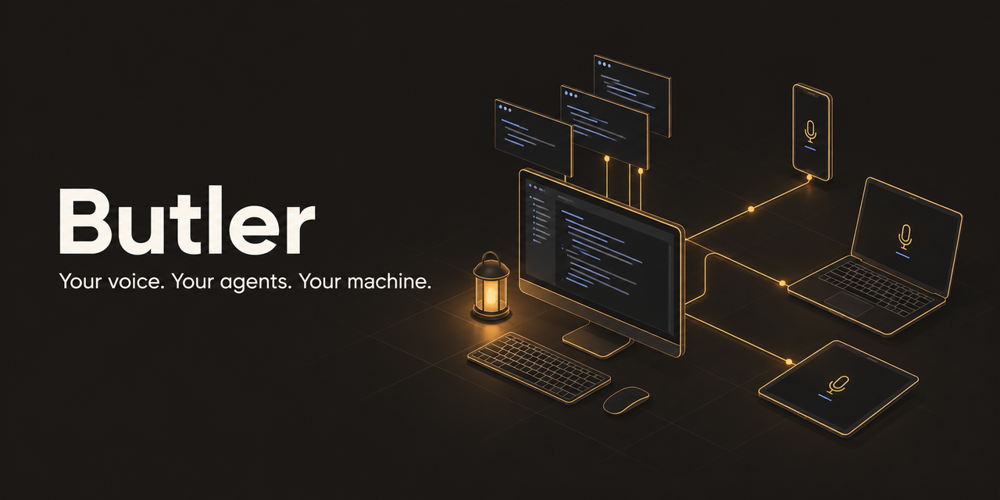
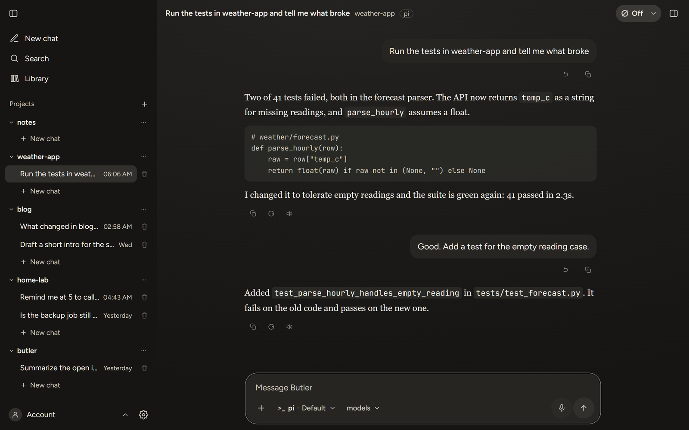
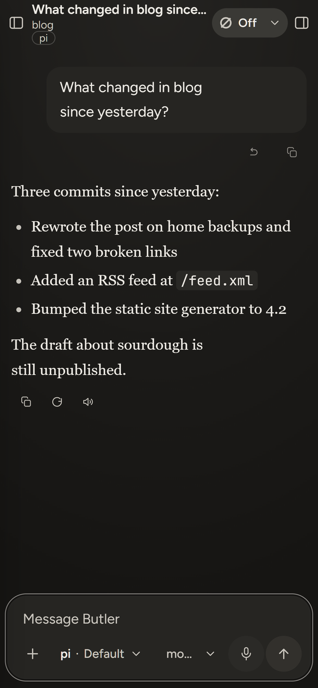
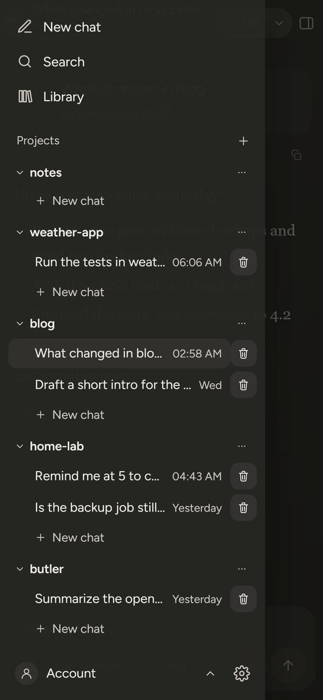
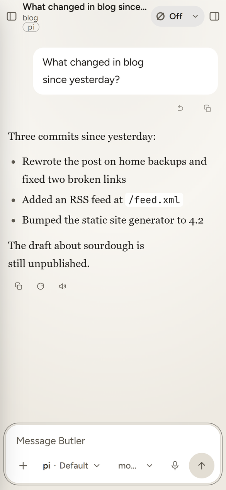
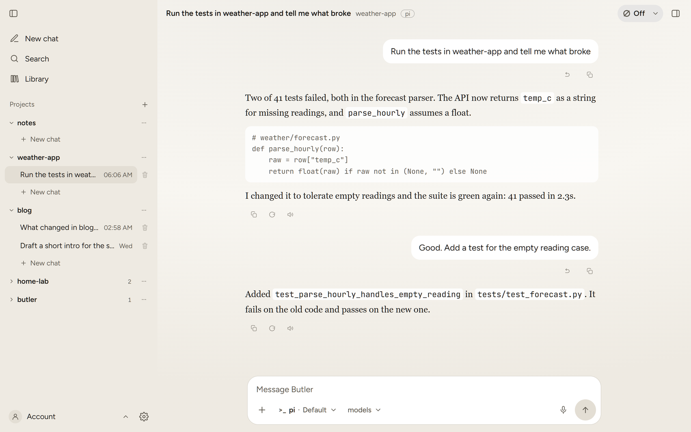
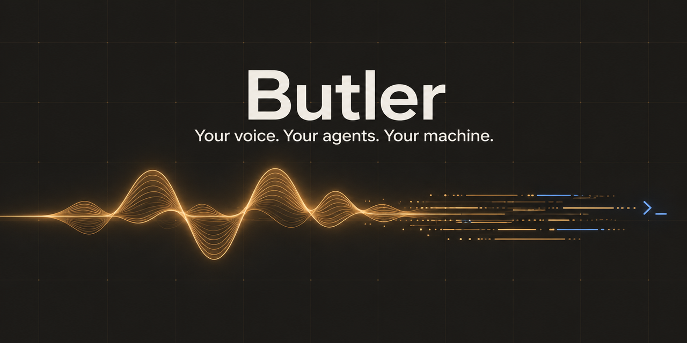
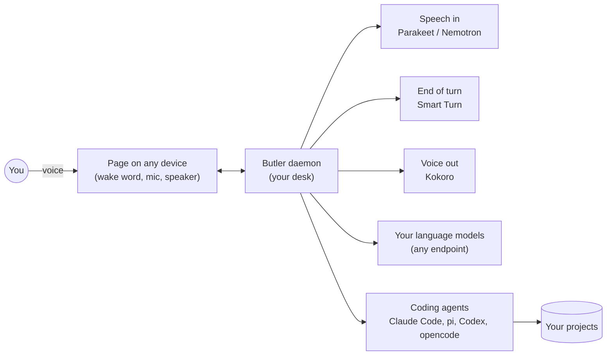

<p align="center">
  
</p>

<h1 align="center">Butler</h1>

<p align="center">
  <b>Talk to your computer. It sends coding agents to do the work, then tells you how it went.</b><br>
  An always-on, hands-free voice assistant for one person, on Windows and macOS.
</p>

<p align="center">
  <a href="LICENSE">Apache-2.0</a> &middot;
  <a href="INSTALL.md">Install</a> &middot;
  <a href="SECURITY.md">Security</a> &middot;
  <a href="HISTORY.md">History</a>
</p>

---

Say **"hey butler"**, ask for something, and keep talking. Butler holds the
conversation by voice, and when the request is real work it hands it to a
coding agent (Claude Code, pi, Codex or opencode) running in your project.
When the agent is done, Butler tells you by speech and puts anything long on
the screen instead of reading it at you.

Speech recognition, end-of-turn detection and the voice all run **on your
machine**. The language models are whichever endpoints you choose.

<p align="center">
  
</p>

<p align="center">
  
  
  
</p>

<details>
<summary>Light theme on the desktop</summary>


</details>

## Why?

Why another personal agent when so many are available?

I wanted a simple solution. Multi-project, not locked into one folder. One
that could use my local pi with all my pre-made skills, or local opencode, or
Claude Code, the way I work in front of the computer. I wanted to use local
models, or any API models already on my harnesses. I wanted to connect it to
WhatsApp. I wanted a mobile interface. I wanted it simple, highly functional
and flexible. I wanted to speak to it in real time, with everything running
locally, at potentially zero cost, built on state-of-the-art components.

That's why. If you share the vision, join in.

## What it does

- **Hands-free voice.** A wake word, natural turn-taking (it knows when you
  have finished a sentence), and you can talk over it to stop a reply.
- **Sends real work to coding agents.** Chats can run on Claude Code, pi or
  opencode; several agents can work in parallel, one project at a time each.
  Open a terminal running an agent in any project, in the page or on the
  desk.
- **Every device is a microphone.** Your phone, tablet or a second computer
  joins the same Butler through a web page, usually over Tailscale.
- **Remembers you.** A `SOUL.md` and `USER.md` you can edit, plus facts you
  ask it to remember or forget.
- **Works while you are away.** Recipes (saved prompts), automations on a
  schedule, mail or an event, a to-do list and spoken reminders.
- **Reaches you elsewhere.** Optional WhatsApp and Telegram: send results to
  your phone, or talk to Butler from there.
- **Desk keys (Windows).** Hold a key to dictate into any app; a chord opens
  an agent in a folder.

## How it works

<p align="center">
  
</p>



Three model tiers keep it quick: a fast tier for small talk, a conversation
tier for real discussion, and a worker tier that runs coding agents in the
background.

## Quick start

You need [uv](https://docs.astral.sh/uv/) and Node.js 20+. Then:

Clone this repository, then from its folder:

```
python scripts/install.py
```

The installer sets everything up, fetches the models, and is safe to run
again; `python scripts/install.py --check` tells you what is missing. Start
Butler with `start.bat` (Windows) or `.venv/bin/python -X utf8
scripts/launch.py` (macOS) and open the address it prints.

Installing with an AI agent? Point it at [`INSTALL.md`](INSTALL.md).

## Before you run it

- **It is a personal project, released as-is.** It runs daily for its author
  on a Windows desktop, a Windows laptop and a Mac mini. Expect rough edges.
- **Coding agents run with full permissions** in the folders you give them.
  Read [Security model and its limits](#security-model-and-its-limits) first.
- **Not** telephony, **not** multi-user, **not** a cloud service. One owner.
- **The code is Apache-2.0; the wake-word models are non-commercial.** See
  [License](#license).

## Requirements

- Python 3.13 (what the author uses) and [uv](https://docs.astral.sh/uv/).
- Node.js 20 or newer (`package.json` engines), for the Kokoro speech sidecar
  and the WhatsApp sidecar.
- A modern browser for the UI. Phones need HTTPS for the microphone (see
  below).
- Tailscale is optional; it is the recommended way to reach Butler from a
  phone.
- Speech recognition has a CPU path and a Vulkan GPU path (Metal on macOS).
  The author measured both on a GTX 1080 Ti; no GPU is required.
- The Tauri desktop app (`app/`) is optional and Windows only; building it also
  needs Rust.

## Install

One command, from the repository root, on Windows and macOS:

```
python scripts/install.py
```

Any Python 3.10 or newer runs it; it needs `uv` and Node.js 20+ already on
PATH and stops with the fix if either is missing. `--data DIR` chooses the data
root (default `~/Butler-Data`), `--nemotron` also fetches the optional
multilingual speech model. It is idempotent and stops at the first failure.

Check an install without changing anything:

```
python scripts/install.py --check
```

It must print `N of N ok`. Agents installing Butler for someone: read
`INSTALL.md` first (it carries the rules).

Choose the data root OUTSIDE the repository. Butler's code lives in the repo;
your files and Butler's records live in the data root, with the records in a
hidden `<data>/.butler` folder (`docs/data-root.md`). The installer creates
both and saves `BUTLER_DATA` (`setx` on Windows, so open a new terminal; on
macOS it prints the `export` line instead and never edits a profile). It
refuses to change a `BUTLER_DATA` that is already set, and with none set
it adopts records already at the launcher's Windows fallback rather than
start an empty folder. If `BUTLER_DATA` is
unset, the launcher reads the value saved for your user in the registry, then
falls back to `E:\Butler-Data` on Windows (the author's machine) and
`~/Butler-Data` on macOS. The certificate is generated on first run by
`scripts/make-cert.py`.

### What the installer fetches

`scripts/fetch-models.py` fetches or verifies each file against a pinned
SHA-256: a file already present with the right hash is skipped, one with the
wrong hash stops the script without being overwritten, and a failed download is
deleted. `scripts/fetch-fonts.py` and `scripts/fetch-xterm.py` do the same for
the fonts (served locally, never from a CDN) and the terminal view (xterm.js,
vendored). The model files and their licenses:

- `models/parakeet-unified-en-0.6b-Q8_0.gguf` (speech recognition):
  NVIDIA Open Model License.
- `models/nemotron-3.5-asr-streaming-0.6b-Q8_0.gguf` (optional, with
  `--nemotron`): OpenMDW-1.1.
- `models/smart-turn-v3.2-cpu.onnx` (Smart Turn v3.2 by Pipecat):
  BSD-2-Clause.
- `web/models/hey_jarvis_v0.1.onnx`, `melspectrogram.onnx`,
  `embedding_model.onnx` (openWakeWord v0.5.1): CC BY-NC-SA 4.0,
  non-commercial.
- `web/ort18/ort.wasm.min.js`, `ort-wasm-simd.wasm`, `ort-wasm.wasm`
  (onnxruntime-web): MIT.

You accept each model's license by using it. onnxruntime-web is pinned to
1.18.0 on purpose: releases from 1.19 ship only threaded wasm that iOS
refuses to load.

### macOS

The installer and `scripts/launch.py` run the same way; use
`.venv/bin/python -X utf8 scripts/launch.py` to start. A launchd example for
start-at-login is `scripts/macos/com.butler.daemon.plist`.

Not available on macOS: the desk hotkey agent (keep `hotkeys_enabled` off),
prechecks for automations, the child-lifetime job, and the Tauri desktop app.
Use the browser instead; Safari's File > Add to Dock on
`http://127.0.0.1:8141` gives a desktop-app feel. Details and measured install
results: `docs/macos.md`.

## Run

Windows: double-click `start.bat` (or run it in a terminal). Stop with
`stop.bat`. `start.bat` calls `scripts\launch.py`, the one launcher, which
checks the data root, takes back ports 8140-8142 from any previous Butler,
generates the certificate if missing, appends to `butler.log` (in
`<data>\.butler\logs`), and starts `daemon\butlerd.py --tls`. On macOS run
`scripts/launch.py` directly.

| Port | Name | Binds | Used for |
|------|------|-------|----------|
| 8140 | MAIN | `127.0.0.1`, or every interface when `lan_access` is on; TLS | Phones and other devices |
| 8141 | LOCAL | `127.0.0.1`, plain HTTP | This machine, and the desktop app |
| 8142 | PROXIED | `127.0.0.1`, plain HTTP | Target of `tailscale serve` |

On the same machine open `http://127.0.0.1:8141` (no certificate warning), allow
the microphone, and say the wake word ("Hey Jarvis"). Everything else is
configured on the generated Settings page.

## Phones and other devices

Browsers only grant microphone access over HTTPS (localhost excepted), so a
phone cannot just use the PC's plain address.

- Over Tailscale (recommended): Settings > Devices (the phone link) sets up
  `tailscale serve` to forward your `https://<your-pc>.<tailnet>.ts.net` name
  to port 8142. A request arriving that way is treated as the owner only when
  its Tailscale login is in the `tailscale_owners` setting; no pairing needed.
- On the local network: Settings > Access > "Open on the local network" turns
  on `lan_access`, which binds port 8140 on every interface over TLS. Each such
  device must be paired once with a 6-digit code from Settings > Access > "Pair
  a device". The certificate is self-signed, so each device shows a warning
  once; accept it.

The full rules are in `docs/remote-access.md`.

## Security model and its limits

Who gets in is decided by one gate (`daemon/access.py`) for every route and
WebSocket, by which listener the request arrived on, never by a header the
caller controls:

- LOCAL (8141): always the owner. Anything running as a user on this machine
  is therefore the owner.
- MAIN (8140): the owner only from loopback; any other client needs a paired
  device cookie. A fresh install listens on localhost only.
- PROXIED (8142): the owner only when the Tailscale login header matches
  `tailscale_owners`; otherwise a paired device, otherwise refused.

Owner-only actions refuse a paired device: minting pair codes, listing or
removing devices, changing `lan_access` or `tailscale_owners`, creating
webhook triggers, notify channels, model connections, automations, the
WhatsApp link, and project rows.

Limits you should accept before using it:

- Coding agents run as YOU, with tools. claude is started with
  `--dangerously-skip-permissions` from a closed table of agents. An agent can
  read and change anything your account can, including your whole disk. The
  data-root separation prevents accidents, not a determined agent.
- Prompt injection cannot be fully prevented. A message, web page or file that
  an agent or the model reads can try to steer it.
- A paired device can still run coding agents, and what it created while
  paired (for example a notify channel) is not undone by removing it.
- Keep Butler on localhost or Tailscale. Do not port-forward it or expose it
  to the public internet.

## Repository map

| Path | What it is |
|------|------------|
| `daemon/` | The daemon: `butlerd.py` (entry), access gate, settings, turn pipeline, engines (speech recognition, end of turn, TTS, WhatsApp sidecars) |
| `web/` | The satellite page and settings UI: microphone, wake word, playback |
| `desk/` | Windows-only desk agent: global hotkeys, microphone, clipboard |
| `app/` | Tauri desktop app (Windows): window, tray, local pages; see `app/INSTALL.md` |
| `tools/` | Standalone CLIs for other agent harnesses (`wa.py`) |
| `scripts/` | `install.py` (the installer), `launch.py`, `make-cert.py`, `fetch-models.py`, `fetch-fonts.py`, `migrate-data-root.py` |
| `test/` | pytest suite and conformance suites |
| `docs/` | One spec per feature, with owner rulings and measurements |
| `plan.md` | The build contract: user story, acceptance criteria (AC-n), defect catalogue (D-n) |
| `AGENTS.md` | Contracts for coding agents working here; a hierarchy with one file per subtree (`daemon/`, `desk/`, `web/`, `app/`, `test/`) |

Specs live in `docs/`; a spec's criteria are promoted to numbered acceptance
criteria in `plan.md`. Some specs and code comments cite `.references/`
(reviews of prior art) and `docs/lessons/` (the engineering journal); those
folders are kept private and are not part of the public repository.

## Tests

```bat
.venv\Scripts\python.exe -X utf8 -m pytest test -q -m "not slow and not needs_gpu"
```

Some tests need the model files in `models\`, the generated audio fixtures
(`needs_audio`), or `node_modules`; they fail or error if those are missing.
The WhatsApp sidecar has its own tests: `npm run test:whatsapp`.

## License

Copyright 2026 The Butler authors. Licensed under the Apache License,
Version 2.0; see `LICENSE`.

The model files are not covered by that license. Each comes under its
publisher's license, listed under "What the installer fetches" above, and
`scripts/fetch-models.py` downloads all of them but one. The exception is the
default wake word, `web/models/hey_butler.onnx`, which ships here: it was
trained for Butler with livekit-wakeword on synthetic speech plus background
audio that includes ACAV100M, the dataset behind openWakeWord's
non-commercial license, so treat it the same way. openWakeWord's own
pre-trained models (`hey_jarvis_v0.1.onnx` and the two feature models every
wake word needs) are CC BY-NC-SA 4.0. In short: the code is Apache-2.0, and
the wake word path is for non-commercial use only.
